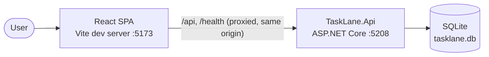
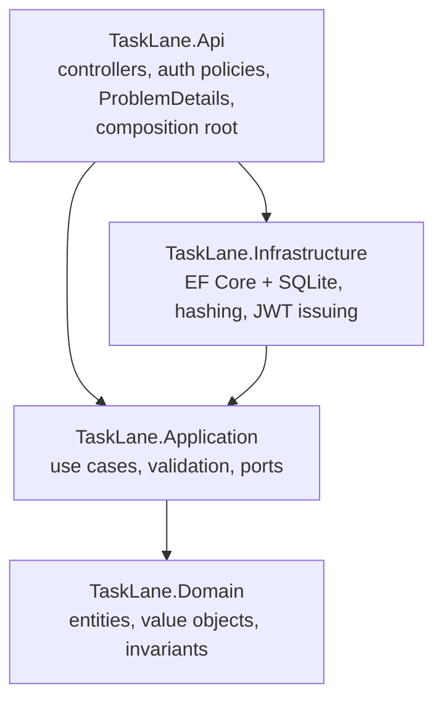
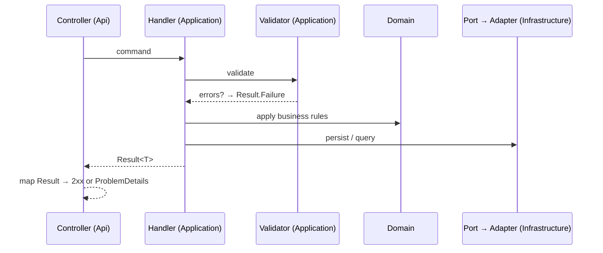
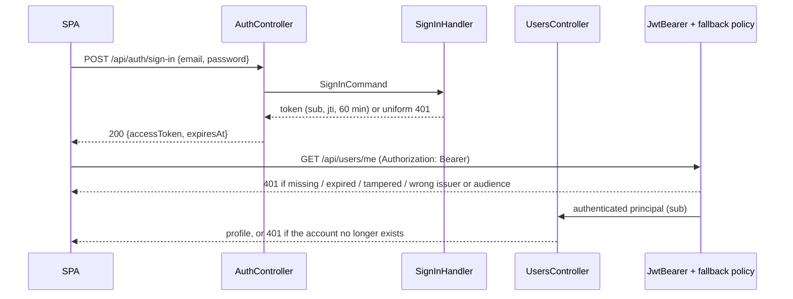

# Architecture

TaskLane is a full-stack application: an ASP.NET Core Web API (.NET 10) following Clean
Architecture with vertical slices, a SQLite database accessed through EF Core, and a React SPA.
Decisions and trade-offs are recorded in [ADRs](adr/README.md); engineering principles in the
[constitution](../.specify/memory/constitution.md).

## System context



## Layers and dependency rule



Dependencies point inward only. This is enforced by the project graph (an outward reference is a
circular dependency) and by `TaskLane.ArchitectureTests`, which also forbid EF Core, SQLite, and
ASP.NET Core assemblies in Domain and Application.

## Vertical slices inside the layers

Each layer is organized by **module** and then by **use case**. A use case keeps everything it
needs together; slices never call each other.

```
src/
├─ TaskLane.Domain/
│  └─ <Module>/                 entities and value objects of the module
├─ TaskLane.Application/
│  └─ <Module>/
│     ├─ Ports/                 interfaces the module needs from the outside
│     └─ <UseCase>/             Command/Query, Handler, Validator, Response
├─ TaskLane.Infrastructure/
│  ├─ Persistence/              AppDbContext, Configurations/, Migrations/
│  └─ <Module>/                 adapters implementing the module's ports
└─ TaskLane.Api/
   └─ <Module>/                 controller(s) and HTTP contracts for the module
```

Request flow for a use case:



## Modules

| Module | Purpose | Status |
|---|---|---|
| Identity | Registration, sign-in, JWT issuing, current-user profile, demo account | Implemented by [`specs/001-user-authentication`](../specs/001-user-authentication/spec.md) |
| Business module(s) | Defined by future specs | Not started |

### Identity module

| Layer | Contents |
|---|---|
| Domain | `Identity/User` — registration invariants and the single email normalization rule |
| Application | Ports `IUserRepository`, `IPasswordHasher`, `IAccessTokenIssuer`; slices `Register`, `SignIn`, `GetProfile`; `IdentityLog` (auth events, no PII) |
| Infrastructure | `UserRepository` (EF Core; unique-index violation → `false`), `PasswordHasherAdapter` (`PasswordHasher<T>`), `JwtAccessTokenIssuer`, `JwtOptions`, `DemoAccountSeeder` |
| Api | `AuthController` (`POST /api/auth/register`, `POST /api/auth/sign-in`, anonymous), `UsersController` (`GET /api/users/me`), `AuthenticationSetup` |

Authentication pipeline:



The SPA keeps `{accessToken, expiresAt}` in `sessionStorage` (per tab). `RequireAuth` guards
protected routes and remembers a safe `returnTo`; any 401 ends the session and shows the expiry
message when `expiresAt` has passed.

Modules interact only through public contracts (e.g. the authenticated user id claim). See
[ADR 0003](adr/0003-identity-module-in-a-single-host.md).

## Cross-cutting concerns

| Concern | Approach |
|---|---|
| Errors | RFC 9457 Problem Details for every error response ([ADR 0010](adr/0010-http-api-conventions.md)) |
| Expected failures | `Result`/`Error` values from handlers, mapped to HTTP in the Api ([ADR 0007](adr/0007-use-cases-without-mediator.md)) |
| Validation | FluentValidation in Application; invariants in Domain |
| Authentication | JWT bearer, authenticated-by-default fallback policy ([ADR 0006](adr/0006-jwt-bearer-authentication.md)) |
| Time | `TimeProvider` injected; never `DateTime.UtcNow` in business code |
| Configuration | `appsettings*.json` + user-secrets / environment variables for secrets |
| Health | `GET /health` including a database check |
| API docs | OpenAPI + Scalar in Development |

## Frontend structure

```
frontend/src/
├─ app/            composition root: AppProviders (session, query client, router), route table, pages
├─ features/       one folder per feature (components, hooks, API calls, tests)
├─ shared/         API client (ProblemDetails → ApiError), layout, UI primitives
└─ test/           test setup and render helpers
```

Server state is managed by TanStack Query; there is no global client store. The only client
state shared across screens is the session (`features/auth/session`). See
[ADR 0009](adr/0009-frontend-stack.md).
