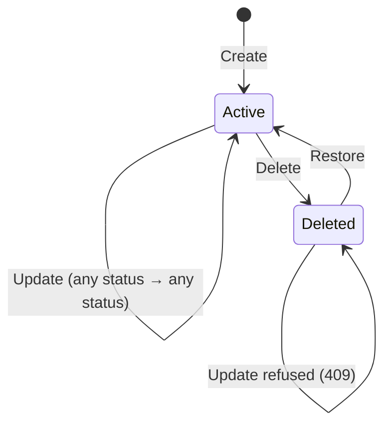

# Data Model: Task Management

## Entity: `TaskItem` (Domain, `TaskLane.Domain.Tasks`)

| Field | Type | Rules |
|---|---|---|
| `Id` | `Guid` | Version 7, assigned on creation; never changes |
| `OwnerId` | `Guid` | Id of the owning account (`sub`); set on creation; never changes |
| `Title` | `string` | Trimmed; 1–200 chars |
| `Description` | `string?` | ≤ 2,000 chars; empty or whitespace-only is stored as `null` |
| `Status` | `TaskItemStatus` | `ToDo` (default), `InProgress`, `Done`; any transition allowed |
| `DueDate` | `DateOnly?` | 2000-01-01 … 2099-12-31 inclusive, or `null` |
| `CreatedAt` | `DateTimeOffset` | UTC, from `TimeProvider` at creation |
| `UpdatedAt` | `DateTimeOffset` | UTC; equals `CreatedAt` at creation; set by `Update` only |
| `DeletedAt` | `DateTimeOffset?` | UTC when deleted; `null` when active |

Derived: `IsDeleted => DeletedAt is not null`.

**Behavior**:
- `TaskItem.Create(id, ownerId, title, description, status, dueDate, now)` is the only constructor
  for new tasks.
- `Update(title, description, status, dueDate, now)` replaces the four editable values and sets
  `UpdatedAt`. It throws `InvalidOperationException` if the task is deleted.
- `Delete(now)` sets `DeletedAt` if the task is active and does nothing if it is already deleted.
- `Restore()` clears `DeletedAt` and does nothing if the task is already active. It does not change
  `UpdatedAt`.
- Invariant violations throw `ArgumentException`: an empty or whitespace title, lengths over the
  maximum, a due date outside the range, a non-UTC timestamp, an empty id or an empty owner id.
  User input is validated earlier by the Application validators, which report field errors.

**Constants**: `TitleMaxLength = 200`, `DescriptionMaxLength = 2000`,
`MinDueDate = 2000-01-01`, `MaxDueDate = 2099-12-31`.

**State transitions**:

## Table: `Tasks` (Infrastructure, configuration + migration `AddTasks`)

| Column | SQLite type | Constraints |
|---|---|---|
| `Id` | TEXT | Primary key |
| `OwnerId` | TEXT | NOT NULL, FK → `Users.Id` ON DELETE CASCADE |
| `Title` | TEXT | NOT NULL, max 200 |
| `Description` | TEXT | NULL, max 2000 |
| `Status` | TEXT | NOT NULL, max 20 (enum stored as its name) |
| `DueDate` | TEXT | NULL (`yyyy-MM-dd`) |
| `CreatedAt` | INTEGER | NOT NULL (`DateTimeOffsetToBinaryConverter`) |
| `UpdatedAt` | INTEGER | NOT NULL (same converter) |
| `DeletedAt` | INTEGER | NULL (same converter) |

**Indexes**: `IX_Tasks_OwnerId_DeletedAt_DueDate` and `IX_Tasks_OwnerId_DeletedAt_CreatedAt`. They
cover the default orders of both lists, scoped to the owner.

## Input validation (Application, FluentValidation)

Field names in errors follow the JSON bodies and query strings: `title`, `description`, `status`,
`dueDate`, `search`, `dueFrom`, `dueTo`, `sort`, `direction`, `page`, `pageSize`.

| Use case | Field | Rule | Message |
|---|---|---|---|
| Create, Update | `title` | Not empty after trim; ≤ 200 after trim | "Title is required." / "Title must be at most 200 characters." |
| Create, Update | `description` | ≤ 2,000 | "Description must be at most 2,000 characters." |
| Create | `status` | Optional; if present, one of the names | "Status must be one of: ToDo, InProgress, Done." |
| Update | `status` | Required; one of the names | "Status is required." / same as above |
| Create, Update | `dueDate` | Optional; `yyyy-MM-dd`; 2000-01-01 … 2099-12-31 | "Enter a due date between 2000-01-01 and 2099-12-31." |
| List | `search` | ≤ 200 after trim | "Search must be at most 200 characters." |
| List | `status` | Optional; one of the names | "Status must be one of: ToDo, InProgress, Done." |
| List | `dueFrom`, `dueTo` | Both or neither; valid `yyyy-MM-dd`; `dueFrom ≤ dueTo`; span ≤ configured maximum (default 90 days) | "Choose both a start and an end date." / "Enter dates as YYYY-MM-DD." / "The start date must be on or before the end date." / "Choose a range of at most {N} days." |
| List | `sort` | Active list: `dueDate`, `createdAt`, `title`. Deleted list: those plus `deletedAt` | "Sort must be one of: …" |
| List | `direction` | `asc` or `desc`; when missing, the sort field's default: `dueDate` asc, `title` asc, `createdAt` desc, `deletedAt` desc | "Direction must be asc or desc." |
| List | `page` | ≥ 1 | "Page must be 1 or greater." |
| List | `pageSize` | 1–100 | "Page size must be between 1 and 100." |

The span is `dueTo − dueFrom` in days: 2026-01-01 → 2026-04-01 is 90 days and is accepted, and one
more day is rejected.

## Shared types

- `PagedResult<T>` (Application/Tasks): `Items`, `Page`, `PageSize`, `TotalCount`.
- `TaskResponse` (Application/Tasks): `Id`, `Title`, `Description`, `Status`, `DueDate`,
  `CreatedAt`, `UpdatedAt`, `DeletedAt`. It never contains `OwnerId`, which is implied by the
  session.
- `TaskListOptions` (Application/Tasks): `DueDateRangeMaxDays` (default 90, 1–3650), from
  configuration section `Tasks`.
